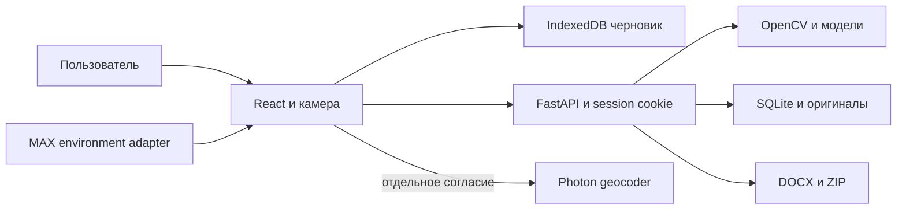

# Архитектура

React/Vite/TypeScript → same-origin FastAPI → SQLite и закрытые оригиналы файлов. OpenCV проверяет кадры, FastALPR запускает ONNX-детектор и русский OCR Nomeroff, Ultralytics — модель дорожных знаков DL-teammm. Параметры API в API_CONTRACT.md.

Фото доступны через сессию владельца. Сервер сохраняет оригиналы и метаданные; заменённые версии остаются в ZIP и удаляются с записью. При смене кадра снимается подтверждение и старый анализ. В manifest перечислены SHA-256, источники и версии; хеш не доказывает подлинность события.

Передача координат Photon требует отдельного выбора на экране. Без него доступен ручной адрес. Сервер ограничивает частоту, кеширует ответы и обрабатывает отказ. Публичный Nominatim автоматически не включён. MAX-адаптер только определяет окружение — без выдуманной авторизации и отправки ботом.

HttpOnly cookie — случайный секрет; БД хранит его хеш. Чужой ID даёт 404. API не кеширует личные данные. Изменения проверяют Origin, файлы — размер, сигнатуру и декодирование. Перед публичным запуском нужны учётные записи, политика хранения, HTTPS, защита нагрузки и уточнение лицензий.
